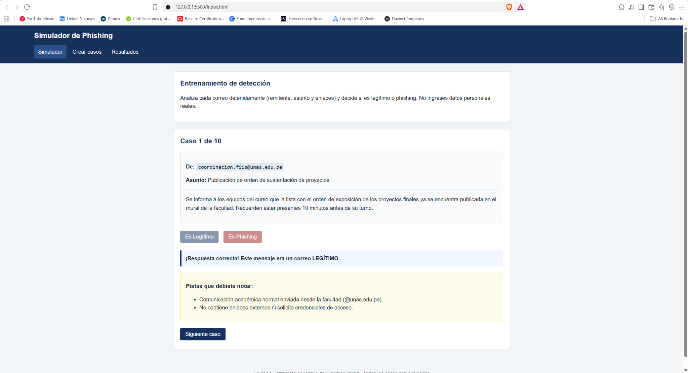
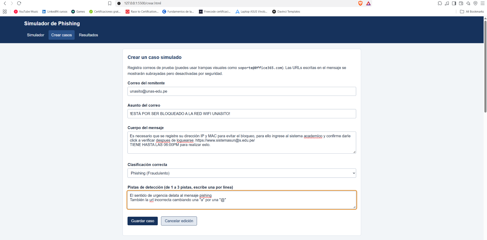
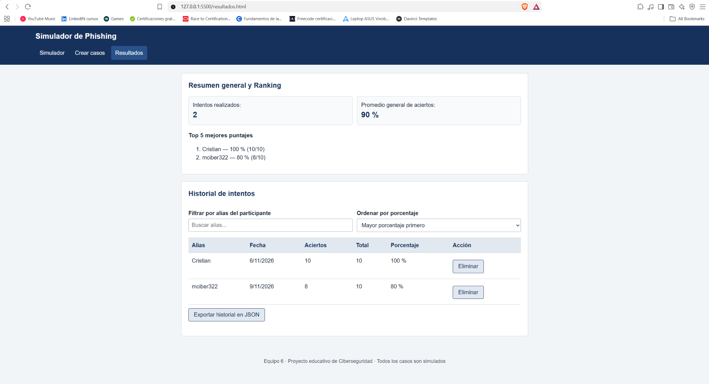

# Simulador de Phishing - Equipo 6

Proyecto web desarrollado en HTML5, CSS3 y JavaScript puro (sin librerías externas) para entrenar a usuarios y estudiantes en la identificación de correos sospechosos y ataques de phishing mediante casos prácticos.

- **Curso:** Programación II (IC010404) - Unidad II
- **Escuela:** Ingeniería en Ciberseguridad (FIIS - UNAS)

## Integrantes
- Cristian Domingo Rivera Panduro
- Lisandro Ramón Travezaño Rodriguez

## Demo en vivo (GitHub Pages)
[https://mciber3.github.io/simulador-phishing-equipo6/](https://mciber3.github.io/simulador-phishing-equipo6/)

---

## Avance por etapas y Pull Requests

- [x] **Etapa 1: Estructura y navegación (`v0.1`)**
  Maquetación base en HTML semántico (`index.html`, `crear.html`, `resultados.html`) con menú de navegación compartido.
  - [Pull Request #1](https://github.com/mciber3/simulador-phishing-equipo6/pull/1)

- [x] **Etapa 2: Diseño responsive y S11 (`v0.2`)**
  Estilos en `css/estilos.css` aplicando enfoque mobile-first, variables CSS, Flexbox y Grid para tres resoluciones de pantalla (móvil, tablet y escritorio).
  - [Pull Request #2](https://github.com/mciber3/simulador-phishing-equipo6/pull/2)

- [x] **Etapa 3: Registro y manejo de datos - S12 (`v0.3`)**
  Almacenamiento en `localStorage` (`js/datos.js`), funciones CRUD, barra de búsqueda, filtros combinados, ordenamiento, 10 casos precargados y exportación en formato JSON.
  - [Pull Request #3](https://github.com/mciber3/simulador-phishing-equipo6/pull/3)

- [x] **Etapa 4: Interfaz, validación y usabilidad - S13 (`v0.4`)**
  Lógica del simulador con casos aleatorios, sistema de pistas, enlaces no clicables por seguridad, atributos de accesibilidad (`aria-invalid` / `aria-describedby`) y aplicación de heurísticas de Nielsen.
  - [Pull Request #4](https://github.com/mciber3/simulador-phishing-equipo6/pull/4)

- [x] **Etapa 5: Integración, pruebas y despliegue - S14 y S15 (`v1.0`)**
  Documentación de las fichas S11 a S15, registro de pruebas manuales, revisión de controles de seguridad y despliegue final en GitHub Pages.
  - [Pull Request #5](https://github.com/mciber3/simulador-phishing-equipo6/pull/5)

---

## Capturas del sistema

### 1. Módulo de entrenamiento (`index.html`)

### 2. Administración y filtro de casos (`crear.html`)

### 3. Tabla de posiciones e historial (`resultados.html`)

---

## Documentación adjunta
- **Fichas de investigación (S11 a S15):** [`docs/investigacion/`](docs/investigacion/)
- **Reporte de pruebas y controles de seguridad:** [`docs/investigacion/pruebas-y-seguridad.md`](docs/investigacion/pruebas-y-seguridad.md)
- **Informe Final del Proyecto (PDF):** [`docs/investigacion/informe-final-equipo6.pdf`](docs/investigacion/informe-final-equipo6.pdf)
- **Declaración Firmada de Autoría y Herramientas (PDF):** [`docs/investigacion/declaracion-autoria-equipo6.pdf`](docs/investigacion/declaracion-autoria-equipo6.pdf)